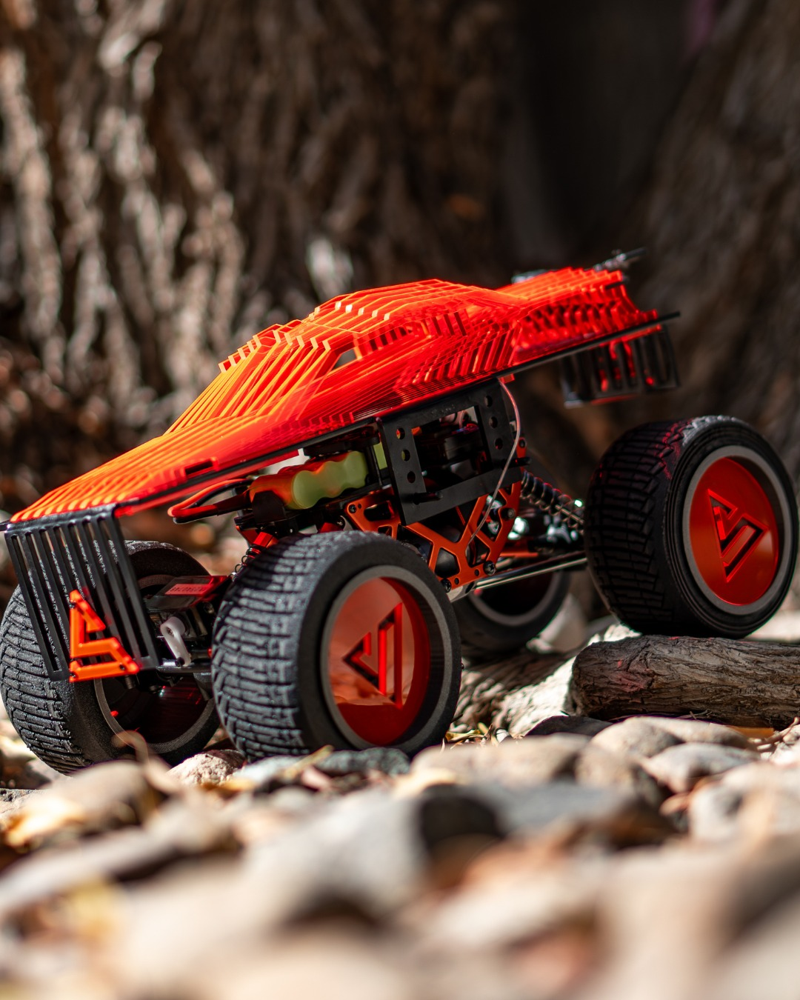

# Project Strata - 4x4 in Schools

Project Strata was my Dubai College team for the ADNOC Land Rover 4x4 in Schools UAE challenge. I worked as the electrical engineer and resource manager. We designed, built, tested, and programmed an autonomous vehicle for an off-road obstacle course.

My work involved electronics, Arduino-based control, CAD, testing, and helping the team source components. We placed second in the Professional Category.

## Evidence

- [Project Strata on Instagram](https://www.instagram.com/dubaicollege_projectstrata/)
- [Finished vehicle photo](photos/4x4-final-car.jpg)
- [CAD and fabrication work](photos/project-strata-cad-work.jpg)

